<div align="center">
  <h1><code>GPIB Server</code></h1>
  <p>SSH / Web controlled IEEE-488 (GPIB) controller on a single ESP32-S3</p>
  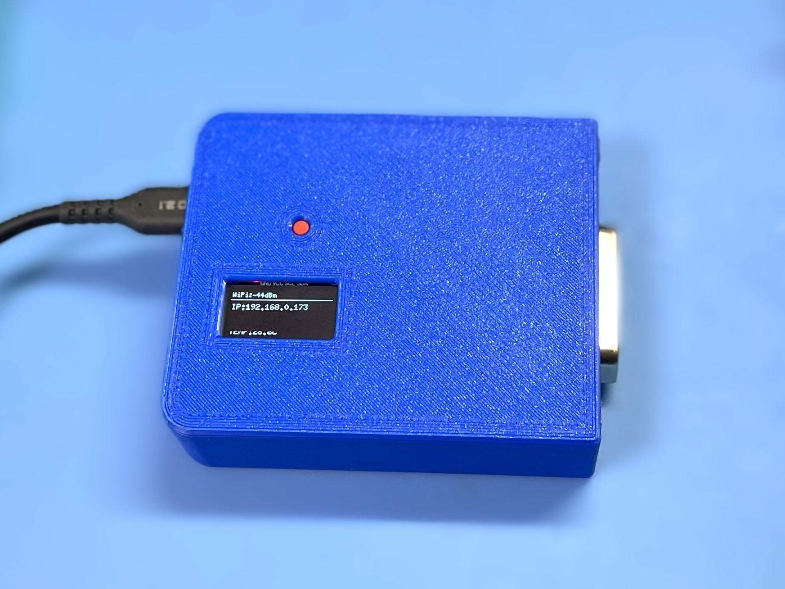
</div>

# gpib-server — SSH-to-GPIB Bridge for ESP32-S3

Firmware for the ESP32-S3 **GPIB-Server** board. It drives an IEEE-488 (GPIB)
bus directly from GPIO through SN75160B / SN75161B bus transceivers. Measuring
instruments can be controlled over Wi-Fi with an **SSH** session or the
**browser terminal**, using **Prologix-compatible** `++` commands.

It is written in Rust (esp-idf-hal / esp-idf-svc), with a C component (wolfSSH)
for the SSH server. It is derived from
[ssh-serial-bridge](#release-history) v0.1.2.

## Features

| Feature | Description |
|---------|-------------|
| GPIB controller | System controller / controller-in-charge on the GPIB bus (IFC, REN, ATN, SRQ, serial poll, SDC, GET, GTL, LLO) |
| Prologix-compatible commands | `++addr`, `++read`, `++auto`, `++eos`, `++eoi`, `++spoll`, `++clr`, `++trg` … (controller mode) |
| SSH server | Port 22, password authentication via wolfSSH, interactive (`gpib`) and script (`gpib raw`) modes |
| WebSocket terminal | Built-in xterm.js GPIB terminal at `/terminal` |
| Spectrum view | Real-time trace display of an ADVANTEST R3267 (R3200 series) spectrum analyzer at `/spectrum` (binary capture on the ESP32, ~13 frames/s) |
| Power supply page | Control and monitoring of an HP / Agilent 6612B (SCPI) DC power supply at `/psu`: output, set values, protection, trend chart, CSV |
| Multimeter page | HP / Agilent 34401A digital multimeter at `/dmm`: function, range, resolution, null, statistics, trend chart, CSV |
| Web UI | Browser-based configuration and device status (GPIB address, SRQ, SSH sessions) |
| Mini display | SSD1306 128×64 OLED (I2C): Wi-Fi, IP, GPIB address, chip temperature |
| WPS support | Wi-Fi Protected Setup (PBC mode) |
| OTA update | `ssh … update < app.bin` with automatic rollback |
| UDP Syslog | RFC 5424 remote logging over UDP |
| NTP | Time synchronisation on boot; up to 4 servers |
| NVS settings | Persistent configuration stored in NVS; editable via Web UI at runtime |

---

## Screenshots

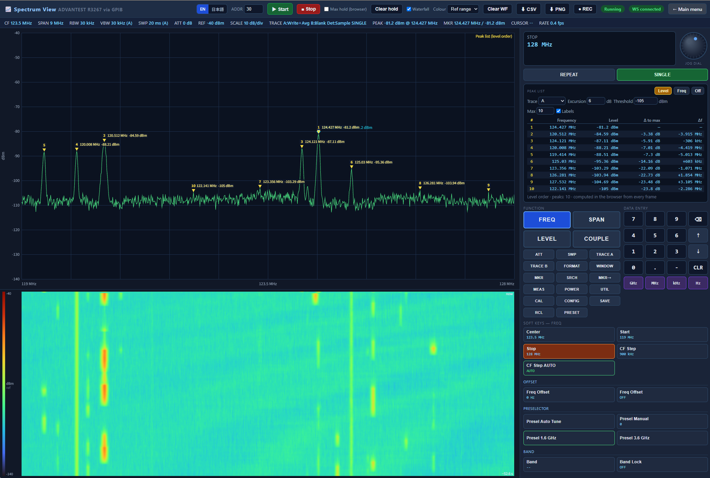

<table>
<tr>
<td align="center" width="50%"><a href="doc/web_menu.png">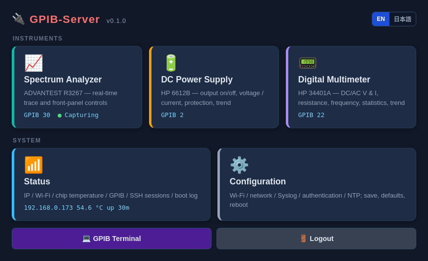</a><br><b>Main menu</b> (<code>/</code>)</td>
<td align="center" width="50%"><a href="doc/web_terminal.png">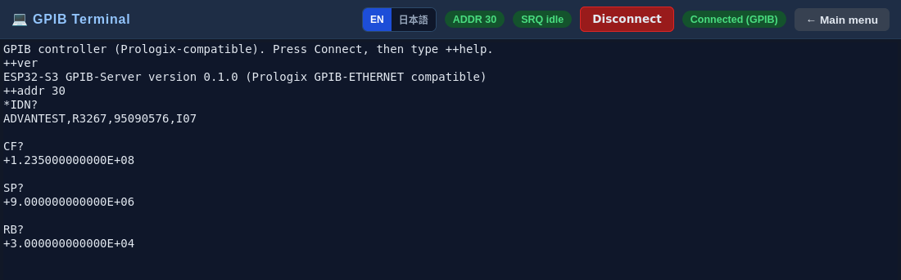</a><br><b>GPIB terminal</b> (<code>/terminal</code>)</td>
</tr>
<tr>
<td align="center"><a href="doc/web_psu.png">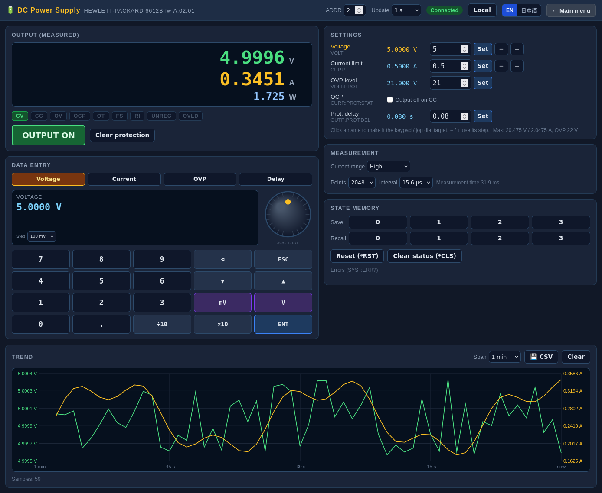</a><br><b>DC power supply</b>, HP 6612B (<code>/psu</code>)</td>
<td align="center"><a href="doc/web_dmm.png">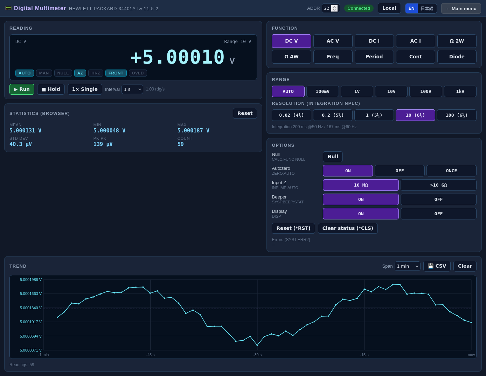</a><br><b>Digital multimeter</b>, HP 34401A (<code>/dmm</code>)</td>
</tr>
<tr>
<td align="center"><a href="doc/web_status.png">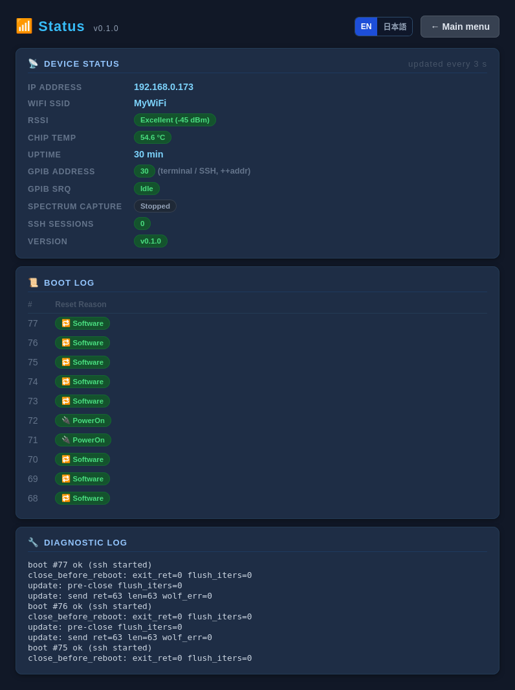</a><br><b>Status</b> (<code>/status</code>)</td>
<td align="center"><a href="doc/web_config.png">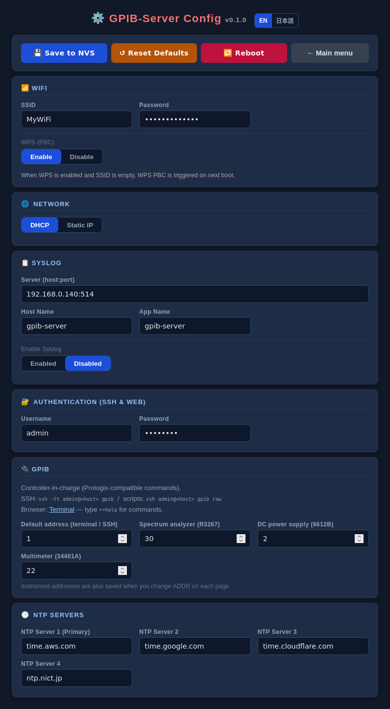</a><br><b>Configuration</b> (<code>/config</code>)</td>
</tr>
<tr>
<td align="center" colspan="2"><a href="doc/web_login.png">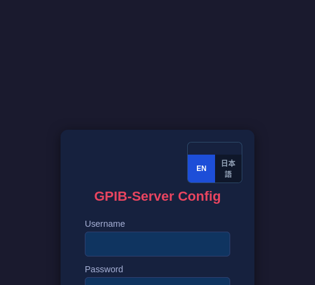</a><br><b>Login</b> (<code>/login</code>)</td>
</tr>
</table>

The power supply and multimeter screenshots were taken with simulated instrument
replies; the other pages show the live device (Wi-Fi name and passwords replaced).

## Release History

### v0.1.0 (gpib-server)

- First GPIB-Server release, derived from ssh-serial-bridge v0.1.2.
- Added the GPIB controller driver and the Prologix-compatible command interpreter (`src/gpib.rs`).
- Added the SSH `gpib` / `gpib raw` commands and the browser GPIB terminal.
- Removed UART (COM1/COM2), USB CDC host, GPIO/PWM outputs, SPI display, ADC / power detection and the related SSH commands (`console usbN/comN`, `power`, `dcpower`, `powercycle`, `pwm`).
- Moved the mini display SDA to GPIO13.
- The console log now goes to USB-C (USB-Serial-JTAG).

---

## Architecture

```
SSH client ──[TCP:22]──► ssh_bridge.c (wolfSSH)
                               │  per-session ring buffers (PSRAM)
                               ▼
                        bridge.rs (SSH / WebSocket glue)
                               │
Browser ──[HTTP/WS]──► httpserver.rs ──► gpib.rs
 ├── /          (configuration page)      ├── Prologix-compatible interpreter (worker thread)
 └── /terminal  (xterm.js + /ws/serial)   └── GPIB bus driver (GPIO, 3-wire handshake)
                                                 │
                         SN74LVC245A ×2 ── SN75160B / SN75161B ── GPIB connector
```

---

## Hardware

<table>
<tr>
<td align="center" width="33%"><a href="doc/front.jpg">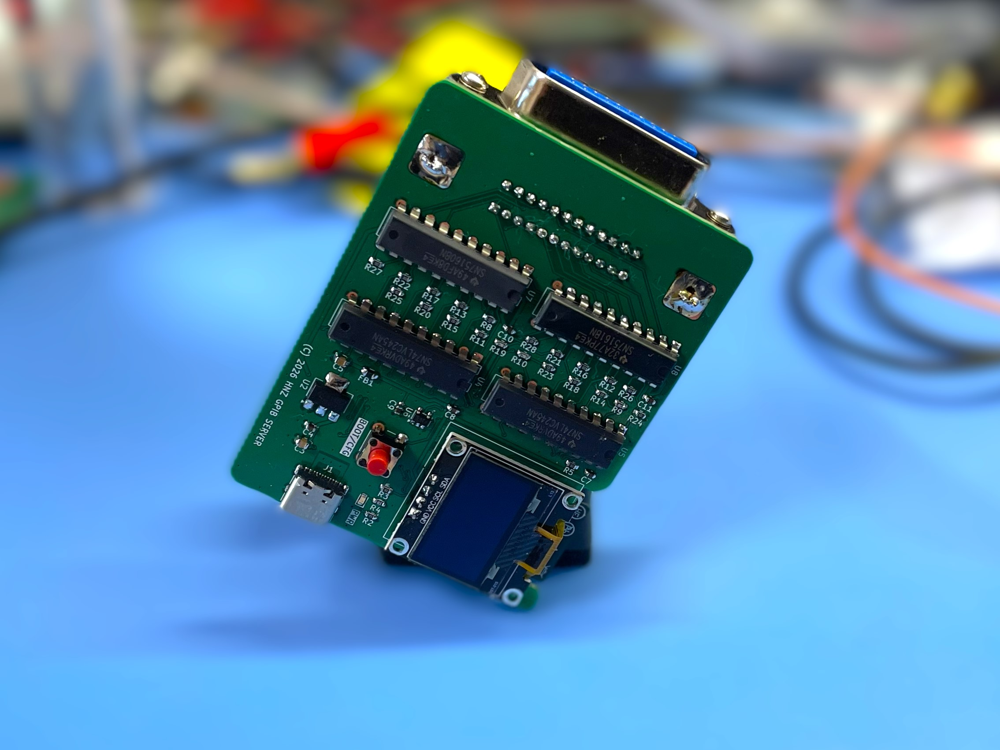</a><br><b>PCB</b>: SN75160B / SN75161B transceivers, SN74LVC245A buffers, USB-C, BOOT/CFG button and SSD1306 OLED; the IEEE-488 connector is on the back</td>
<td align="center" width="33%"><a href="doc/box.jpg"></a><br><b>Case</b> (3D-printed): USB-C power on the left, GPIB connector on the right</td>
<td align="center" width="33%"><a href="doc/display.jpg">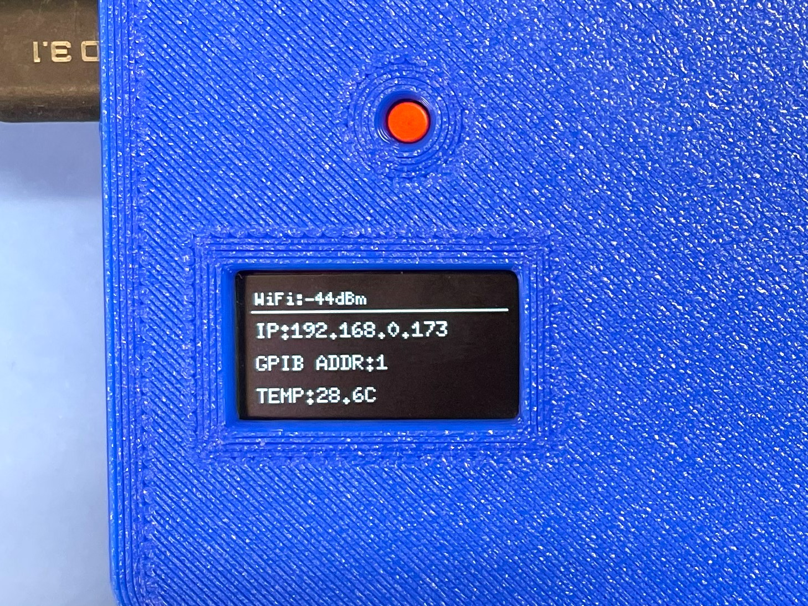</a><br><b>Mini display</b>: Wi-Fi RSSI, IP address, GPIB address and chip temperature</td>
</tr>
</table>

### Case (3D printing)

| File | Part | Size (W × D × H) |
|------|------|------------------|
| [`hw/body.stl`](hw/body.stl) | Body | 86 × 67 × 25 mm |
| [`hw/upper.stl`](hw/upper.stl) | Upper part | 91 × 76 × 27 mm |

Sizes are the bounding boxes of the STL files.

The schematic is in [`hw/GPIB-Server.kicad_sch`](hw/GPIB-Server.kicad_sch) ([PDF](hw/schematic.pdf)). For the
design rationale (level translation, direction control and pull-ups), see
[`doc/gpib-hardware.md`](doc/gpib-hardware.md).

| Ref | Part | Function |
|-----|------|----------|
| U1 | ESP32-S3-WROOM-1-N16R8 | MCU (16 MB flash, 8 MB octal PSRAM) |
| U2 | AZ1117-3.3 | 5 V (USB VBUS) → 3.3 V LDO |
| U3 | SSD1306 module | 128×64 OLED (I2C) |
| U4 | SN74LVC245A | DIO1–8 buffer (3.3 V, 5 V-tolerant) |
| U5 | SN74LVC245A | DAV / EOI / NRFD / NDAC buffer (NRFD/NDAC wired B→A reversed) |
| U6 | SN74LVC1G34 | SRQ input buffer |
| U7 | SN75160B | GPIB data transceiver (5 V) |
| U8 | SN75161B | GPIB management transceiver (5 V, DC = GND → system controller) |
| J1 | USB-C (device) | 5 V power, flashing and console (USB-Serial-JTAG) |
| J2 | IEEE-488 24-pin | GPIB connector |

### Pin Assignment

| GPIO | Signal | Direction (ESP32 side) | Path |
|------|--------|------------------------|------|
| 4–11 | DIO1–DIO8 | bidirectional (TE) | U4 → U7 |
| 15 | DAV  | bidirectional (same as TE) | U5 A1/B1 → U8 |
| 18 | EOI  | bidirectional (same as TE) | U5 A2/B2 → U8 |
| 16 | NRFD | bidirectional (inverse of TE) | U5 B3/A3 (reversed) → U8 |
| 17 | NDAC | bidirectional (inverse of TE) | U5 B4/A4 (reversed) → U8 |
| 21 | ATN  | output | 1 kΩ → U8 |
| 38 | REN  | output | 1 kΩ → U8 |
| 39 | IFC  | output | 1 kΩ → U8 |
| 40 | SRQ  | input  | U8 → U6 |
| 12 | TE   | output (direction: H = talk) | U7/U8 TE, U4/U5 DIR (10 kΩ pull-down) |
| 2  | OE#  | output (LVC245A enable, active low) | U4/U5 OE (10 kΩ pull-up) |
| 13 | I2C SDA | — | OLED |
| 3  | I2C SCL | — | OLED |
| 0  | BOOT button | input | Long press (≥ 10 s): factory reset |
| 46 | (strap) | — | 10 kΩ pull-down (download mode works with the BOOT button) |
| 19 / 20 | USB D− / D+ | — | USB-C (USB-Serial-JTAG) |

The GPIB bus uses negative logic: a LOW level means asserted, and a data bit of 1
is driven LOW. The firmware handles the inversion.

### Button

| GPIO | Function |
|------|----------|
| 0 (BOOT) | Long press (≥ 10 s): erase NVS and restore `cfg.toml` defaults. A countdown is shown on the mini display from 5 s onwards. |

---

## Directory Layout

```
gpib-server/
├── src/
│   ├── main.rs           # Entry point, peripheral initialisation
│   ├── gpib.rs           # GPIB bus driver + Prologix-compatible interpreter
│   ├── bridge.rs         # SSH (C component) / WebSocket ⇄ GPIB glue
│   ├── httpserver.rs     # HTTP/WebSocket server, NVS config management
│   ├── wifi.rs           # Wi-Fi STA connection (DHCP / static IP / WPS)
│   ├── mini_display.rs   # SSD1306 status display
│   ├── syslogger.rs      # UDP Syslog logger (RFC 5424)
│   ├── btn_ctrl.rs       # GPIO0 button (long press: factory reset)
│   └── boot_log.rs       # NVS boot counter and rolling reset-reason log
├── components/
│   ├── ssh_bridge/       # SSH server C component (wolfSSH wrapper)
│   ├── wolfssh/          # wolfSSH (github.com/wolfSSL/wolfssh, commit 157cb01f)
│   └── wolfssl/          # wolfSSL/wolfCrypt (github.com/wolfSSL/wolfssl, commit b7e7e755)
├── doc/gpib-hardware.md  # Hardware design notes (pin list, connections, rules)
├── hw/
│   ├── GPIB-Server.kicad_* # KiCad project, schematic and PCB
│   ├── schematic.pdf     # Schematic (PDF)
│   ├── production/       # Gerber (zip), BOM, positions, netlist for PCB assembly
│   ├── body.stl          # Case: body (3D printing)
│   └── upper.stl         # Case: upper part (3D printing)
├── static/               # Embedded pages and files (menu, status, spectrum, psu, dmm; xterm.js (gzip) / css / fit addon)
├── cfg.toml.example      # Template for cfg.toml (build-time defaults; cfg.toml itself is not in git)
├── sdkconfig.defaults    # ESP-IDF build settings
├── partitions.csv        # Flash partition table
├── setup_components.sh   # Initial setup script for components/
└── setup_env.sh          # One-shot environment setup (Rust, espup, udev)
```

---

## Configuration

### cfg.toml (build-time defaults)

Copy `cfg.toml.example` to `cfg.toml` and edit it for your environment before
building (`cfg.toml` holds credentials and is ignored by git). The section name must
match the crate name (`gpib-server`).

```toml
[gpib-server]
wps_enable     = "true"     # "true": use WPS PBC on next boot when SSID is empty
wifi_ssid      = "your-ssid"
wifi_psk       = "your-password"
ip_mode        = "dhcp"           # "dhcp" or "static"
ip_address     = "192.168.0.200"
subnet_mask    = "255.255.255.0"
gateway        = "192.168.0.1"
dns            = "1.1.1.1"

syslog_server    = "192.168.0.140:514"
syslog_enable    = "false"
syslog_host_name = "gpib-server"
syslog_app_name  = "gpib-server"

ssh_user     = "admin"
ssh_password = "gpibpass"

# NTP servers (up to 4, in priority order)
ntp_server1 = "time.aws.com"
ntp_server2 = "time.google.com"
ntp_server3 = "time.cloudflare.com"
ntp_server4 = "ntp.nict.jp"

mini_display_enable = "true"      # SSD1306 OLED (U3)

gpib_addr = "1"      # terminal / SSH (++addr) address at power-up
sa_addr   = "30"     # ADVANTEST R3267 (/spectrum)
psu_addr  = "2"      # HP 6612B (/psu)
dmm_addr  = "22"     # HP 34401A (/dmm)
```

Values in `cfg.toml` are compiled into the firmware as defaults.
After boot they can be overridden via the Web UI; NVS values take priority.

### GPIB addresses

The four `*_addr` keys are defaults (0–30). They are stored in NVS when changed:

- **Configuration page → GPIB**: all four addresses. "Save to NVS" stores them;
  `gpib_addr` (the address selected at power-up for `++` commands) takes effect
  after a reboot.
- **ADDR field on /spectrum, /psu, /dmm**: changing it saves that instrument's
  address to NVS immediately (`POST /api/gpib_addr`), so every browser opens the
  page with the same address.

`++addr` in a terminal / SSH session changes the address only for the running
session and is not saved. Other GPIB settings (EOS, timeouts …) are not stored in
NVS either; set them with `++` commands, as on a Prologix adapter. Reset Defaults
(or the 10 s BOOT-button press) returns all addresses to the `cfg.toml` values.

---

## Wi-Fi Setup with WPS

The device supports **WPS Push Button Configuration (PBC)**.

1. In `cfg.toml`, set `wifi_ssid = ""` and `wps_enable = "true"`. Alternatively,
   clear the SSID and enable WPS in the Web UI, then reboot.
2. Flash the firmware (or reboot).
3. On boot, the device enters WPS mode and the mini display shows
   **"WPS MODE"**. Press the **WPS button on your router** within 2 minutes.
4. On success, the credentials are saved to NVS ("WPS SUCCESS" → "CONNECTED").

To return to WPS mode on a configured device, perform a **factory reset**: hold
the BOOT button (GPIO0) for **≥ 10 seconds**. This restores the `cfg.toml`
defaults, so WPS starts if `cfg.toml` has an empty SSID.

If WPS fails or times out, the device falls back to the configured credentials.
Only PBC mode is supported (PIN mode is not).

---

## Environment Setup

Run `setup_env.sh` **once** on a fresh Ubuntu / Debian machine (or WSL2) before
building.

```bash
bash setup_env.sh
source "$HOME/.cargo/env"
source ~/export-esp.sh
```

| Step | Action |
|------|--------|
| 1 | Install system packages via `apt` |
| 2 | Install Rust toolchain via `rustup` (skipped if already present) |
| 3 | Install `ldproxy`, `espup`, `cargo-espflash` via Cargo |
| 4 | Install & update the ESP32-S3 Xtensa toolchain via `espup` |
| 5 | Source `~/export-esp.sh` (generated by `espup`) |
| 6 | Add udev rule for ESP32 USB device (`303a:1001`) and reload rules |

---

## Build and Flash

### Initial component setup

Run this once after cloning, after a clean wipe of `components/`, or after moving
the checkout. The last case matters because it rewrites the absolute
partition-table path in `sdkconfig.defaults`.

```bash
bash setup_components.sh
```

### Build

```bash
cargo build --release
```

### Flash and monitor (USB-C)

Connect the board's USB-C port to the PC. The ESP32-S3 appears as a
USB-Serial-JTAG device (`303a:1001`), which is used for both flashing and the
log console.

```bash
espflash flash --release --monitor
```

If the device does not enter download mode automatically, hold **BOOT**, press
reset (or re-plug USB), then release BOOT.

### Images for distribution / OTA

```bash
# Merged full-flash image (write at offset 0x0)
cargo espflash save-image --release --merge --chip esp32s3 flash_images/flash_gpib-server.bin

# App-only image for `ssh … update` (OTA)
cargo espflash save-image --release --chip esp32s3 flash_images/app_gpib-server.bin
```

Always write the merged image at **offset 0x0**:

```bash
espflash write-bin 0x0 flash_images/flash_gpib-server.bin
```

### Flash layout

| Partition     | Offset   | Size    |
|---------------|----------|---------|
| nvs           | 0x9000   | 24 KB   |
| otadata       | 0xF000   | 8 KB    |
| phy_init      | 0x11000  | 4 KB    |
| ota_0 (app)   | 0x20000  | 4032 KB |
| ota_1 (app)   | 0x410000 | 4032 KB |

Flash: 8 MB layout, DIO mode, 40 MHz. The N16R8 module has 16 MB of flash;
the upper 8 MB are currently unused.

---

## SSH Connection

| Item | Detail |
|------|--------|
| Port | 22 (TCP) |
| Auth method | Password only (public-key authentication is not supported) |
| Username | Any string is accepted — only the password is checked |
| Password | `ssh_password` in `cfg.toml` or Web UI |
| Concurrent sessions | Up to 6 total; up to 4 sessions can share the GPIB console |

> **Security note:** Change the default password before you put the device on a
> shared network. Remote control of instruments such as power supplies can be
> hazardous.

### Commands

| Command | Description |
|---------|-------------|
| `ssh -tt <user>@<ip> gpib` | Interactive GPIB console (local echo, auto-read after each line) |
| `ssh <user>@<ip> gpib raw` | Prologix-style raw console (no echo, `++auto 0`) for scripts |
| `ssh -tt <user>@<ip> console gpib` | Alias of `gpib` |
| `ssh <user>@<ip> reboot` | Reboot the ESP32-S3 |
| `ssh <user>@<ip> update < app.bin` | OTA firmware update |

Disconnect an interactive session with **Enter**, then **`~.`**

### Interactive example

```
$ ssh -tt admin@192.168.0.200 gpib
Connected to ESP32-S3 GPIB-Server v0.1.0 [gpib].
Type ++help for commands. Disconnect: Enter then ~.

++addr 22
*IDN?
KEITHLEY INSTRUMENTS INC.,MODEL 2000,...
:MEAS:VOLT:DC?
+1.23456789E+00
++spoll
0
```

In interactive mode, every line that does not start with `++` is sent to the
instrument (with the EOS terminator). The response is then read automatically,
up to EOI or LF. Error messages (timeouts, no listener …) are printed only in
interactive mode.

### Prologix-compatible commands

| Command | Description | Default |
|---------|-------------|---------|
| `++addr [pad [sad]]` | Get/set instrument address (pad 0–30, sad 96–126) | `gpib_addr` (1) |
| `++auto [0\|1]` | Read automatically after each write | 1 interactive / 0 raw |
| `++clr` | Selected Device Clear (SDC) | |
| `++eoi [0\|1]` | Assert EOI with the last byte of writes | 1 |
| `++eos [0-3]` | Write terminator: 0 = CR+LF, 1 = CR, 2 = LF, 3 = none | 2 |
| `++eot_enable [0\|1]` | Append `eot_char` to read data when EOI is seen | 0 |
| `++eot_char [0-255]` | Character appended when `eot_enable` = 1 | 10 |
| `++ifc` | Interface Clear | |
| `++llo` | Local Lockout | |
| `++loc` | Go To Local (GTL) for the current address | |
| `++mode [1]` | Controller mode only (always 1) | 1 |
| `++read [eoi\|<char>]` | Read until EOI, `<char>` (decimal) or timeout | |
| `++read_tmo_ms [ms]` | Read / handshake timeout, 1–60000 ms | 3000 |
| `++rst` | Re-initialise the GPIB bus (IFC + REN) | |
| `++spoll [pad [sad]]` | Serial poll; returns the status byte | |
| `++srq` | SRQ line state (1 = asserted) | |
| `++trg [pad …]` | Group Execute Trigger (GET) | |
| `++ver` | Version string | |
| `++help` | Command list | |
| `++echo [0\|1]` | *(extension)* local echo / CRLF conversion | 1 interactive / 0 raw |
| `++ren [0\|1]` | *(extension)* REN line | 1 |
| `++savecfg` | Accepted for compatibility (no effect) | |

To send CR, LF, ESC or `+` as data, prefix the character with ESC (0x1B).

Not supported: device mode (`++mode 0`, `++lon`, `++status`) and parallel poll.

### Scripting

`gpib raw` behaves like a Prologix adapter. Send `++` commands and data lines
to stdin, and read the responses from stdout:

```bash
ssh admin@192.168.0.200 gpib raw
++addr 22
*IDN?
++read eoi
```

To use the device from software that speaks the Prologix-over-TCP protocol (for
example, PyVISA with pyvisa-py's Prologix support), expose the SSH session as a
local TCP port:

```bash
socat TCP-LISTEN:1234,reuseaddr,fork EXEC:"ssh admin@192.168.0.200 gpib raw"
```

> When stdin reaches EOF, the session may close before a pending response
> arrives. For one-shot pipes, keep stdin open until the reply has been read
> (for example, use `socat` or an interactive client).

### OTA firmware update

```bash
cat flash_images/app_gpib-server.bin | ssh admin@192.168.0.200 update
```

- Use the **app-only** image, not the merged image.
- The update is written to the inactive OTA slot. The new image is marked valid
  once the SSH server starts; otherwise the bootloader rolls back on the next
  reset.

---

## Web UI

| URL | Method | Description |
|-----|--------|-------------|
| `/login` | GET / POST | Login (same user / password as SSH) |
| `/logout` | GET | Logout |
| `/` | GET | Main menu: Status, Spectrum Analyzer, DC Power Supply, Configuration, GPIB terminal, logout (auth required) |
| `/status` | GET | Device status (IP, Wi-Fi, chip temperature, uptime, GPIB, spectrum capture, SSH sessions) and boot / diagnostic log (auth required) |
| `/config` | GET | Configuration page: Wi-Fi, network, Syslog, authentication, NTP; save / defaults / reboot (auth required) |
| `/terminal` | GET | Browser GPIB terminal (auth required) |
| `/spectrum` | GET | R3267 real-time spectrum view (auth required) |
| `/psu` | GET | DC power supply (HP 6612B) control page (auth required) |
| `/dmm` | GET | Digital multimeter (HP 34401A) page (auth required) |
| `/ws/serial` | WS | Terminal data (`{"cmd":"init","port":"gpib","token":…}`, then binary frames) |
| `/ws/spectrum` | WS | Spectrum control (`{"cmd":"start"\|"stop",…}`) and trace frames |
| `/ws/inst` | WS | Instrument-page requests (`{"cmd":"req","dev":"psu"\|"dmm","addr":2,"q":"VOLT 5\|MEAS:VOLT?",…}`) and replies |
| `/api/config` | POST | Save configuration to NVS |
| `/api/gpib_addr` | POST | Save an instrument page's address to NVS (`dev=sa\|psu\|dmm&addr=0..30`) |
| `/api/status` | GET | IP / Wi-Fi / chip temperature / GPIB address / SRQ / SSH sessions / spectrum running / uptime (JSON) |
| `/api/reset` | POST | Erase NVS and restore cfg.toml defaults |
| `/api/reboot` | POST | Reboot the device |
| `/api/boot_log` | GET | Boot history with reset reasons (JSON) |
| `/api/diag_log` | GET | Diagnostic entries stored in NVS (JSON) |


After login the **main menu** opens. Each page (status, spectrum view, power
supply, configuration, terminal) has a **← Main menu** button that returns to it.

The browser terminal behaves like the interactive SSH console (echo +
auto-read). It shares the GPIB interpreter with any SSH sessions.

**Language.** Every page (login, configuration, terminal, spectrum view) can be
shown in English or Japanese. Use the **EN | 日本語** switch in the page header.
The choice is stored in the browser (localStorage); the default follows the
browser language. Hover help and messages follow the same setting. The R3267
front-panel key names (FREQ, Center, Ref Level, …) stay in English, as on the
instrument.

Login sessions are held in RAM only, so they become invalid when the ESP32
restarts. Every page then shows a **"Session expired"** notice with a **Reload**
button, triggered by HTTP 401 from `/api/*` or by `{"type":"auth","error":…}`
on the WebSocket. Reloading leads to the login page.

WebSocket messages must carry the login session token. The `/terminal`,
`/spectrum`, `/psu` and `/dmm` pages embed it, and messages with a missing or wrong token are ignored.

### Power supply page (`/psu`)


Controls an **HP / Agilent 6612B** system DC power supply (20 V / 2 A, SCPI) on
the GPIB bus. Commands follow the Agilent programming guide 5962-8198, which
covers 66312A / 6631B–6634B / 6611C–6614C; the 6612B uses the same platform. Other
models of that family work too, because the limits are read from the instrument.
The default address is **2** (`psu_addr`); a changed address is saved to NVS.
Open the page from **DC Power Supply** in the main menu.

| Area | Function | SCPI |
|------|----------|------|
| Output (measured) | Voltage, current (mA below 20 mA), power; mode badges CV / CC; protection badges OV / OCP / OT / FS / RI / UNREG / OVLD | `MEAS:VOLT?` `MEAS:CURR?` `STAT:OPER:COND?` `STAT:QUES:COND?` |
| | **OUTPUT ON / OFF** | `OUTP ON\|OFF` |
| | **Clear protection** (blinks when a protection has tripped) | `OUTP:PROT:CLE` |
| Settings | Voltage, current limit: value + **Set** (or Enter), − / + by the selected step | `VOLT` `CURR` |
| | OVP level, OCP (output off on CC), protection delay | `VOLT:PROT` `CURR:PROT:STAT` `OUTP:PROT:DEL` |
| Data entry | **Keypad** and **jog dial** for the active setting (Voltage / Current / OVP / Delay; also selected by clicking a setting name). Type a value and press **V/A/s** or **ENT** (or **mV/mA/ms** for milli units). ▲ ▼ and the jog dial change it by the step; ÷10 / ×10 change the step; Shift = 10 × step | `VOLT` `CURR` `VOLT:PROT` `OUTP:PROT:DEL` |
| Measurement | Current range High / Low 20 mA, points × interval (measurement time shown) | `SENS:CURR:RANG` `SENS:SWE:POIN` `SENS:SWE:TINT` |
| State memory | Save / recall states 0–3 (with confirmation), reset, clear status | `*SAV` `*RCL` `*RST` `*CLS` |
| | Error log | `SYST:ERR?` (read on every update) |
| Trend | Voltage (green) and current (yellow) against time; CC / OFF periods are shaded. **CSV** downloads every sample (time, V, A, W, mode) | — |
| Toolbar | Update interval 0.5 / 1 / 2 / 5 s or **Pause**; **Local** = Go To Local | GTL |

- Keyboard: 0-9 and `.` type a value, Enter sets it, `m` sets it in milli units,
  Backspace / Esc edit; ↑ → / ↓ ← = jog (Shift = coarse). These keys work when no
  input field has the focus. Jog ticks are combined and sent at most about 7 times
  per second, each as one absolute value (e.g. `VOLT 5.3`). The step of each
  setting and the active setting are stored in the browser.
- Set values are limited to the model maxima (`VOLT? MAX`, `CURR? MAX`,
  `VOLT:PROT? MAX`; 6612B: 20.475 V, 2.0475 A, OVP 22 V). Programming a voltage at
  or above the OVP level shows a warning, because OVP would trip.
- While the page polls, the instrument stays in remote and its front panel is
  locked. To use the front panel, press **Local**, which also sets Update to Pause.
- One request runs at a time: commands, then the setting queries, then the
  measurements. The ESP32 accepts only the commands listed above
  (`gpib::validate_psu_item`). Other SCPI commands can be sent from the terminal
  (`++addr 2`).
- Requests are interleaved with the spectrum view on the same bus, so both
  pages can be open at once.
- Tested with a 6612B (firmware A.00.05). It does not support `SENS:WIND`
  (error -113), so the page has no window setting.
- The R3267 also uses address 30 by default. Give each instrument its own address.

### Multimeter page (`/dmm`)


Controls an **HP / Agilent 34401A** 6½-digit multimeter. Commands follow the
34401A User's Guide, chapter 4 (Remote Interface Reference). The default address
is **22** (`dmm_addr`); a changed address is saved to NVS. Open the page from
**Digital Multimeter** in the main menu.

| Area | Function | SCPI |
|------|----------|------|
| Reading | Value in the front-panel format: the range sets the prefix and the number of digits. **OVLD** for 9.9E+37 (**OPEN** in continuity / diode). Annunciators AUTO / MAN / NULL / AZ / HI-Z / FRONT·REAR / OVLD | `READ?` `CONF?` |
| | **Run** (continuous), **Hold**, **Single**; interval Fast / 0.5–10 s; readings per second shown | `READ?` |
| Function | DC V, AC V, DC I, AC I, Ω 2W, Ω 4W, Freq, Period, Continuity, Diode | `CONF:…` |
| Range | AUTO or a fixed range of the function (100 mV … 1 kV, 10 mA … 3 A, 100 Ω … 100 MΩ); Freq / Period: input voltage range | `<func>:RANG` `<func>:RANG:AUTO` |
| Resolution | DC / Ω: NPLC 0.02 / 0.2 / 1 / 10 / 100 (4½ … 6½ digits, integration time shown); AC: filter 3 / 20 / 200 Hz; Freq / Period: gate time 10 ms / 100 ms / 1 s | `<func>:NPLC` `DET:BAND` `FREQ:APER` `PER:APER` |
| Options | Null (the next reading becomes the offset), autozero ON / OFF / ONCE, input resistance 10 MΩ / >10 GΩ, beeper, front display | `CALC:FUNC NULL` `CALC:STAT` `ZERO:AUTO` `INP:IMP:AUTO` `SYST:BEEP:STAT` `DISP` |
| | Reset, clear status, error log | `*RST` `*CLS` `SYST:ERR?` |
| Statistics | Mean, min, max, standard deviation, peak-to-peak, count, computed in the browser (reset when the function changes) | — |
| Trend | Readings against time with the mean line; **CSV** downloads every reading (time, value, unit, function, range) | — |

- Each cycle sends `READ?` and then `CONF?`, so the displayed range follows
  autoranging. `CONFigure` sets the trigger source to IMMEDIATE, so `READ?`
  measures at once.
- A reading at 100 NPLC with autozero takes about 3.5 s, so the bus timeout for
  the multimeter is 12 s. During a reading the bus is busy; spectrum frames and
  power-supply requests wait for it.
- The meter stays in remote (Rmt) while the page measures. **Local** stops the
  measurement and sends Go To Local.
- The front / rear terminal switch cannot be set over GPIB; the page only shows it.

### Spectrum view (`/spectrum`)


The page shows a real-time trace from an **ADVANTEST R3267** (R3200-series
GPIB codes). Enter the GPIB address, CENTER [MHz], SPAN [MHz] and RBW [kHz], then
press **Start**. The ESP32 then:

1. sends `DL2` (delimiter = EOI only) and reads back the settings
   (`CF? SP? RB? FA? FB? RL? DD? TP? VB? SW? AT? CS?`, the AUTO flags, and `MN? MF? ML?`);
2. repeats `TS` (take sweep, waits for completion) + `TBA?` (trace A, binary,
   2 bytes × 501/1001 points, high byte first), and pushes each frame to the browser;
3. re-reads the settings every 15 frames and after each panel command, so changes made on the real front panel are picked up too;
4. restores `DL0` (CR LF EOI) on **Stop**, or when the last viewer closes the page.

Press **Start** to capture with the instrument's current settings.

**Front panel (right side).** The panel works like the R3267 front panel:

| Part | Function |
|------|----------|
| REPEAT / SINGLE | REPEAT: continuous capture (`CONTS`). SINGLE: the ESP32 captures one sweep per press, then holds the display (`SNGLS`) |
| Function keys | FREQ / SPAN / LEVEL / ATT / COUPLE / SWP / TRACE A / TRACE B / FORMAT / WINDOW / MKR / SRCH / MKR→ / MEAS / POWER / UTIL / CAL / CONFIG / SAVE / RCL / PRESET — the GPIB-controllable functions of R3267 Operation Manual Vol.1 tables 5-1 … 5-21 |
| Soft keys | Change with the selected function and show the current values and states, for example TRACE A: Write / View / Blank, Max / Min Hold, Average, Sweep Count, Detector, Clear |
| Numeric keys + unit keys | Type a value, then press a unit (GHz/MHz/kHz/Hz, dBm/dB, s/ms/µs, ENTER) to send it |
| Jog dial | Mouse wheel over the dial, the value display or the graph, or drag the dial: fine steps of the active function (hold Shift for coarse steps). Ticks are batched, about 10 commands/s at most |
| ↑ / ↓ | Coarse steps (1-2-5 / 1-3 sequences, CF step, dB/div) |
| Click on the graph | Move the instrument marker there (`MK …`) |
| PC keyboard | Digits, `.`, `-`, Backspace, Esc (clear), Enter (default unit), ↑ / ↓ (coarse), ← / → (jog) |

Soft-key states (ON/OFF, selections, values such as Min ATT) are read with
read-only panel queries when a menu opens, after each key, and every 4 s.
Measurement results are polled every 1.5 s while their mode is on, and shown in
the **RESULT** box. Examples: OBW / Fc, channel / total / average power, ACP,
counter, noise/Hz, %AM, harmonics, C/N, phase jitter, IM, pass/fail,
XY cursor Δ.
List results (ACP, harmonics, C/N, IM) are shown as tables. Each
column has one unit, given in its header, and fixed decimals, so the digits line up.
The `#` column matches the numbered markers on the graph.
With W / V units the graph switches to a linear scale (0 … reference level). In
zero span the X axis, results and marker are shown as time.

Not available from the panel: table entry (limit, correction, CS/BS, spurious and
offset tables), label text, printer / bitmap / file / memory-card operations,
external-mixer functions (R3273 only), and writing the 10 MHz reference
calibration values. PRESET, RCL, SAVE / DEL and the calibrations ask for
confirmation.

The graph shows trace A (green), trace B (magenta, when it is not Blank), the
display line (FORMAT, orange), the instrument marker and the peak.
**Peak list.** The **PEAK LIST** box (below REPEAT / SINGLE) finds the peaks in the
browser, in every captured frame, so the list follows the signal at the frame rate
without extra GPIB traffic. **Level** lists the largest peaks first, **Freq** in
frequency order; **Off** turns it off. Settings (kept in the browser):

| Setting | Meaning |
|---------|---------|
| Trace | Trace A, trace B or the browser max hold |
| Excursion | A peak must rise at least this much (dB) above the lowest point on each side before a higher point (its prominence). Default 6 dB |
| Threshold | Peaks below this level are ignored. Empty = auto: noise floor (median of the trace) + 10 dB |
| Max | Number of peaks listed (1–50, default 10) |
| Labels | Frequency / level label next to each marker |

The table shows each peak's frequency (time in zero span), level, difference to
the largest peak and Δf. The table always has Max rows (blank rows pad a short list; over 10
rows it scrolls), so its height does not change and the keys below stay in place. The peaks are drawn as numbered yellow ▼ markers; labels
that would overlap are left out. Hovering a row highlights its marker with a guide
line; clicking a row moves the instrument marker to that peak (`MK`). The level is
the trace point (no interpolation), as on the instrument display.

The instrument's own peak list (**MKR → Peak List Freq / Level**, `PLS`, `PKLST?`)
is still available. Its markers are shown when the browser list is Off. The R3267
searches only once, when `PLS` is sent, and does not re-sort the list afterwards.
The peak list is also written to the CSV header. The R3267 has no query for the peak-list state,
and `PKLST?` keeps returning the last list after `PLS OFF`. So the page tracks the
state itself: Peak List Freq / Level turns it on, and Peak List OFF, Marker OFF,
PRESET and RCL turn it off. If the peak list is switched on or off on the instrument's
own front panel, the page does not see it.
The **XY cursor** (TRACE A → XY Cursor) is drawn as white dotted X / Y lines
(`XYCSR?`, `CSRX?`, `CSRY?`, read every 3 s and shortly after a cursor key). When an
anchor is set (Set Anchor / `SETANC`), it is drawn as an orange ⊕, and ΔX / ΔY are
shown at the cursor crossing. There is no query for the anchor itself:
`CSRDX?` / `CSRDY?` return the offset from the anchor, or −999999999 when no anchor
is set. So the anchor position is `CSRX − CSRDX`, `CSRY − CSRDY`.
The **peak search condition** (SRCH) has all of its GPIB settings:
- X range All / Inner / Outer, with the search window position and width
  (`MKSPOS`, `MKSWID`) and Couple to F (`MKSCPL`).
- Y range All / display line / limit line, with Above or Below for the display
  line and limit lines 1 and 2 (`MKSYDL`, `MKSYLA`, `MKSYLB`).

The search window is drawn in violet, shaded inside for Inner and outside for
Outer. With Y: Disp Line, the searched side of the display line is shaded.

**Saving (toolbar).** The browser saves the data it already has, so this works
while capturing and needs nothing from the instrument:

| Button | File | Content |
|--------|------|---------|
| ⬇ CSV | `r3267_YYYYMMDD_HHMMSS.csv` | One row per point: `freq_Hz` (or `time_s` in zero span), trace A, trace B (if not Blank), browser max hold (if on), and the lower screen of a split display. `#` header lines hold the settings (CF, span, RBW, VBW, sweep time, ATT, REF, scale, unit, trace modes, detector), the marker, the XY cursor / anchor and the peak list |
| ⬇ PNG | `r3267_YYYYMMDD_HHMMSS.png` | The graph as shown (spectrum, lower screen, waterfall) with a settings line |
| ● REC | `r3267_rec_YYYYMMDD_HHMMSS.csv` | Records every trace-A frame until pressed again: one row per frame (`time` ISO 8601, `elapsed_s`, the level at each point). The first row holds the frequencies. Stops and saves by itself when the frequency axis or level scale changes, or after 20000 frames |

Read the CSV with, for example, `pandas.read_csv(f, comment="#")`.

**Split screen (WINDOW Zoom / F/T / T/T).** The graph splits into an upper and
a lower pane, each with its own axes (for example frequency domain above and
time domain below in F/T). The R3267 sends only the selected screen over GPIB,
so each frame does `SCRSEL TRA` → `TS` → `TBA?` and `SCRSEL TRB` → `TS` → `TBA?`, then
selects the screen the user chose again. The lower screen's settings are sent as
a separate `meta2` message and its trace as frame tag `C`. A pane tag shows which
screen is selected for settings ("◀ active"). Each `SCRSEL` switch takes about
0.4 s, so the update rate drops to about 1 frame/s. With the waterfall on, the
graph area is divided 36 / 28 / 36 %; the waterfall shows the upper screen.

The ESP32 accepts only the panel codes listed in `PANEL_CODES` (`src/gpib.rs`), each
with its allowed argument form: none, `<number><unit>`, or a keyword such as `ON`,
`OFF`, `NRM`, `VIDEO`. Anything else is rejected, for example `DL0`, `TBA` or
`PRESET`. Commands that arrive while a frame is being captured are processed as one
batch, followed by a single full read-back of the settings. A light refresh of the
main values runs every 15 frames.

**Interrupting.** Stop (or Start), Ctrl-C in an interactive SSH or browser-terminal
session, and any panel key pressed while a frame has been stuck for more than 1 s
abort the bus operation in progress. The bus is then reset with IFC.

> **Trigger caution:** with Video / Ext trigger and no trigger signal, a pending
> `TS` (take sweep) makes the R3267 refuse all GPIB data. IFC and Device Clear do
> not help; only the front panel or a power cycle releases it. The capture
> therefore sends `TS` only in Free Run. With other trigger sources it just reads
> the current trace.

The browser converts the raw values with `level = RL + (raw − 14592) / 1280 × dB/div`
(R3267 Operation Manual Vol.1, 5.2.10.3). It draws the trace with a peak marker,
a cursor readout and optional max hold.

While the spectrum view runs, the GPIB bus is shared with SSH and terminal
sessions, so their commands are interleaved between frames. The R3267 delimiter
is `DL2` during capture, so ASCII replies end with EOI only (no CR LF).

For PC-side capture to CSV, see [`tools/r3267_capture.py`](tools/r3267_capture.py).

---

## Dependencies

| Component / Library | Version | License | Purpose |
|---------------------|---------|---------|---------|
| **gpib-server** (this project) | 0.1.0 | MIT | Firmware (Rust) |
| **ssh_bridge** component | 0.1.0 | MIT | SSH server C wrapper |
| esp-idf-hal | 0.45 | MIT / Apache-2.0 | ESP32-S3 hardware abstraction |
| esp-idf-svc | 0.51 | MIT / Apache-2.0 | Wi-Fi, HTTP server, SNTP, etc. |
| **wolfSSH** | commit `157cb01f` | GPLv3 (or commercial) | SSH server protocol |
| **wolfSSL / wolfCrypt** | commit `b7e7e755` | GPLv3 (or commercial) | Cryptography library |
| ssd1306 | 0.8 | MIT / Apache-2.0 | OLED display driver |
| embedded-graphics | 0.8.1 | MIT / Apache-2.0 | Display rendering |
| @xterm/xterm | 6.0.0 (bundled) | MIT | Browser WebSocket terminal |
| @xterm/addon-fit | 0.11.0 (bundled) | MIT | xterm.js terminal fit addon |

> **Note on wolfSSH / wolfSSL licensing:**
> Both wolfSSH and wolfSSL are dual-licensed under **GPLv3** (open source) or a
> **commercial license** (for use in proprietary products).
